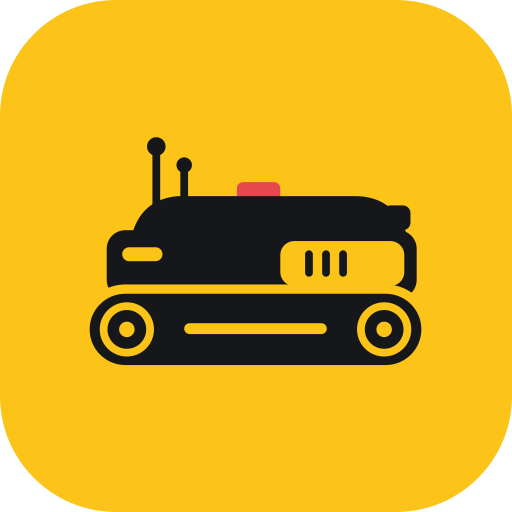
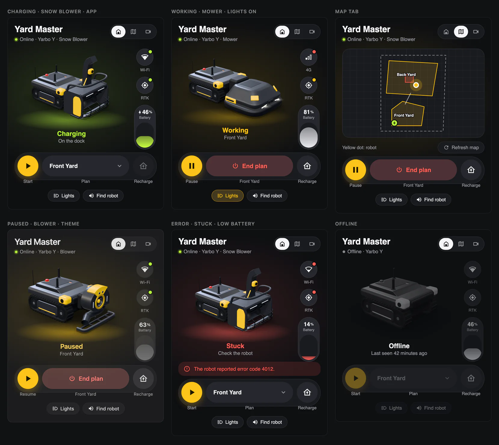
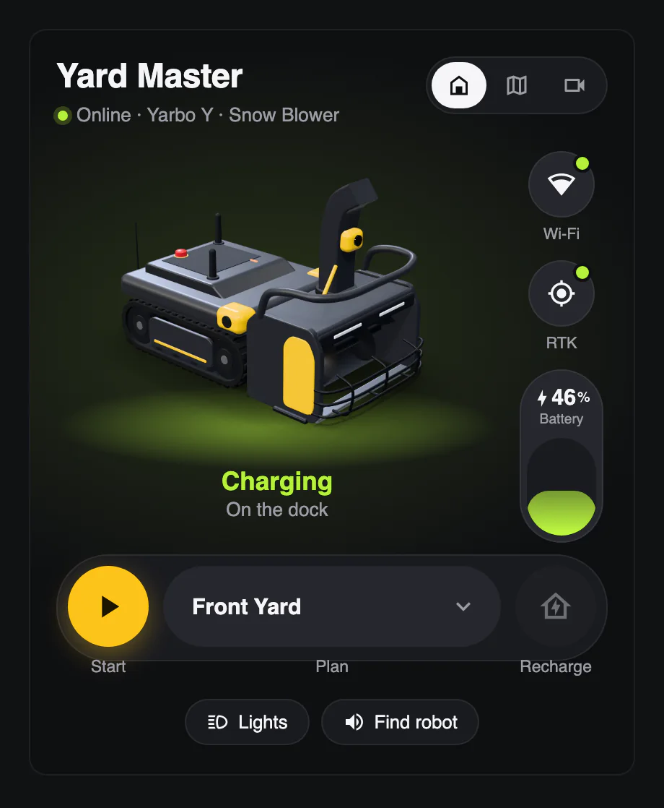
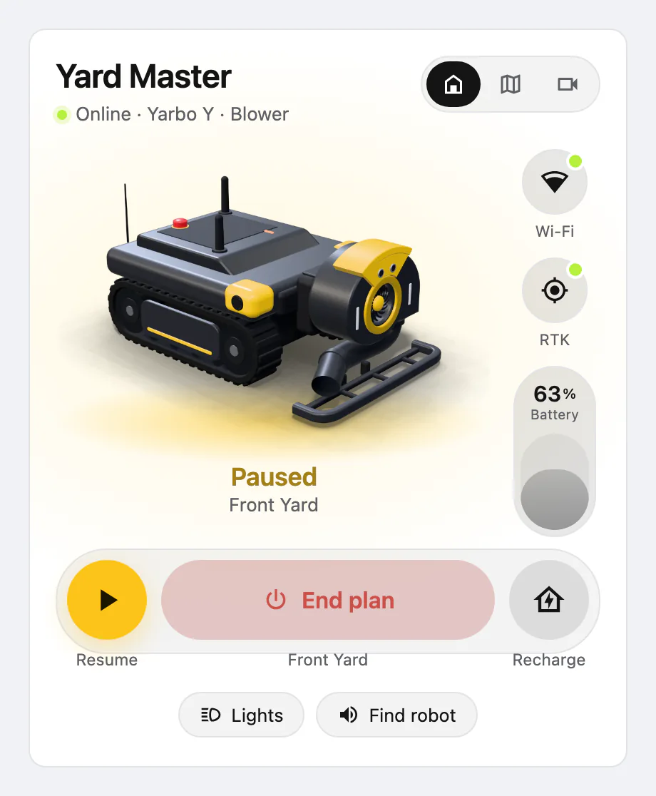

# Yarbo Home Assistant Integration

> Home Assistant custom integration for Yarbo robot devices.  
> Monitor and control your Yarbo Y Series robot directly from Home Assistant.

---

## Features

- Real-time status via Yarbo cloud MQTT push (internet required, no local mode)
- Heartbeat-based online detection — 90s timeout, checked every 5s
- Auto wake-up on connect + renewal every 4 minutes
- Token refresh handled automatically by SDK; re-auth prompt shown if session fully expires
- Choose which devices to monitor at setup; manage anytime via **Configure**
- Command cooldown on controls (5 s for numbers, 15 s for switches) — prevents UI flicker from stale MQTT data

---

## How It Works

This integration connects to Yarbo cloud via the official SDK. Once authenticated, it:

1. Subscribes to **MQTT push** from the Yarbo cloud — no polling, real-time updates only
2. Sends an **initial wake-up command** on connect, then renews it every **4 minutes** to keep the device active
3. Monitors a **heartbeat signal** every 5 seconds — if no heartbeat is received within **90 seconds**, the device is marked offline
4. On startup, fetches a full snapshot of device state, GPS reference, and plan list. If a device is offline at startup, its **DeviceMSG snapshot and Wi-Fi info are automatically re-fetched the moment it comes online** (and refreshed again after any offline→online transition), so those fields recover without a manual **Refresh Device Data** press. Map zones are **restored from a persistent store** (surviving restarts and device-offline periods) and only re-fetched from the device on an explicit **Refresh Map Data** request
5. Handles **token refresh automatically** via the SDK on 401 responses. If re-authentication is required, HA will prompt you.

---

## Supported Entities

### Monitoring

| Type | Entities |
|------|----------|
| **Sensors** | Battery, Error Code, Network (Halow / WiFi / 4G), Head Type, Head Serial Number, Auto Plan Status, Auto Plan Pause Status, Recharging Status, Volume, RTK Signal, Position X/Y, Heading, GPS Satellites, Battery Cell Temperature 1–6 (disabled by default) |
| **Binary Sensors** | Online (heartbeat-driven, 90s timeout), Charging, Battery Temp Error, Stuck, Obstacle Detected, Sound Enabled, Head Light (read-only), Person Detection, Follow Mode |
| **Device Tracker** | Real-time GPS location on HA map ⚠️ Requires RTK fix — shows `unavailable` until RTK is locked. Use **Refresh GPS Reference** after device initialization. |
| **Map Zones** | Work-area zone summary. State = feature count; attributes carry only `zone_summary`, `feature_count`, and center `latitude`/`longitude`. The full GeoJSON is fetched on demand via the `yarbo/map_zones` WebSocket command (kept out of attributes to stay under HA's ~16 KB recorder limit). |

### Controls

| Type | Entities |
|------|----------|
| **Select** | Working State (standby / working), Plan Select |
| **Switch** | Sound Switch, Head Light, Person Detection, Follow Mode, Child Lock, Geo Fence, Ignore Obstacles |
| **Number** | Volume (0–100%), Plan Start Percent (0–99%), Blade Height, Blade Speed, Chute Angle |
| **Button** | Start Plan, Pause Plan, Resume Plan, Stop Plan, Return to Charge, Refresh Plans, Refresh GPS Reference, Refresh Map Data, Refresh Device Data |

> **Start Plan** and **Return to Charge** perform safety precondition checks before executing. If a check fails, a clear error message is shown in the HA UI.

> **Plan Start Percent** is a local-only value — it sets the starting progress point for the selected plan and is used as input for **Start Plan**. Value is restored after HA restart.

> **Blade Height** and **Blade Speed** are shown only when a mower head is detected. **Chute Angle** is shown only when a snow blower head is detected. These controls are disabled by default.

> ⚠️ If LED channels are adjusted individually outside HA (e.g. via the Yarbo app), the Head Light switch state in HA may not reflect the actual device state.

---

## Map Data (Frontend)

The full GeoJSON work-zone map is **not** stored in entity attributes (it can exceed
HA's ~16 KB recorder limit and would be broadcast to every dashboard on each state
write). A frontend card fetches it on demand via a WebSocket command.

**Command contract**

- **Request**: `{ "type": "yarbo/map_zones", "sn": "<serial>" }`
- **Result**: `{ "sn", "geojson": <FeatureCollection>, "center": { "latitude", "longitude" } | null }`
- **Error**: `not_found` when no map is cached yet for that serial (e.g. the initial fetch
  hasn't completed). Press the **Refresh Map Data** button and retry.

**Fetch with error handling**

```js
async function fetchYarboMap(hass, sn) {
  try {
    // -> { sn, geojson, center }
    return await hass.connection.sendMessagePromise({ type: "yarbo/map_zones", sn });
  } catch (err) {
    if (err.code === "not_found") return null; // not ready yet
    throw err;
  }
}
```

**Trigger a refresh, then retry**

```js
// "Refresh Map Data" is a button entity on the device.
await hass.callService("button", "press", {
  entity_id: `button.${sn.toLowerCase()}_refresh_map_data`,
});
// re-fetch after the coordinator has re-cached the map
const map = await fetchYarboMap(hass, sn);
```

**Reactive re-fetch (keep the map live without polling)**

The lightweight `sensor.<sn>_map_zones` entity still updates its state (feature count)
and `zone_summary` whenever the map changes. Subscribe to that entity and re-fetch the
GeoJSON only when it changes — no polling, no large payload on every tick:

```js
hass.connection.subscribeMessage(
  () => fetchYarboMap(hass, sn).then(applyToMapLayer),
  { type: "subscribe_trigger",
    trigger: { platform: "state", entity_id: `sensor.${sn.toLowerCase()}_map_zones` } },
);
```

Cache the result by `sn`; only re-fetch on first render, on the state-change trigger
above, or after a manual **Refresh Map Data**.

---

## Yarbo Card

The integration adds a dashboard card laid out like the Yarbo app: the robot with its
current head, its status, battery, network and RTK signal, and the plan controls.



Add it from the card picker (search **Yarbo**) or in YAML:

```yaml
type: custom:yarbo-card
device_id: <picked in the card editor>   # or sn: <robot serial number>
name: Yard Master        # optional
appearance: app          # app (dark, like the Yarbo app) or theme (follows your dashboard)
show_map: true           # optional, adds a Map tab with your work zones
show_live: true          # optional, adds a Live tab with Smart Vision (admins only)
image: /local/yarbo.png  # optional, shows your own picture instead of the drawing
```

`appearance: app` gives the card the Yarbo app's dark look. `appearance: theme` uses your
dashboard's colors instead:

<p>
  
  
</p>

- **Start, Pause and Resume** use the integration's plan buttons, so their safety checks
  still apply; if one fails, the card shows the reason. **End plan** needs a second tap.
- **Recharge** sends the robot back to its dock. **Lights** and **Find robot** appear when
  those entities are enabled.
- Tapping the battery, network or RTK icons opens that entity's details.
- The **Map** tab draws the zones from **Refresh Map Data**, and the robot's position once
  it has an RTK fix.
- The robot drawing is the card's own artwork, not Yarbo's product images. The screenshots
  use simulated robot data.

---

## Live Feed (Smart Vision)

> ⚠️ **Experimental, not yet confirmed against a real robot.** The request and response
> fields for the video service are not all known yet, so the card may report an error
> naming what the service returned.

The **Live** tab of the Yarbo card plays the robot's cameras. There is also a
stand-alone card for it:

```yaml
type: custom:yarbo-smart-vision-card
sn: <robot serial number>
max_minutes: 5   # optional, stops the feed automatically
mode: live       # optional, Agora channel mode: live or rtc
```

- **The feed is not a `camera` entity.** Smart Vision streams through Agora and the browser
  joins the channel directly, so it can't be used for snapshots, recording, or automations.
- **It only runs when you ask.** It starts when you press **Start**, and stops when you press
  **Stop**, leave the page or hide the tab, or reach `max_minutes`. Smart Vision uses the
  robot's battery, and its monthly allowance on 4G.
- **It's admin-only**, because the card receives credentials for the robot's video channel.
- **It needs internet access.** The card loads a pinned copy of the Agora Web SDK from
  jsDelivr, and video travels through Agora's cloud.
- **Video only.** There is no audio or voice intercom.

---

## Precondition Checks

### Start Plan

Before sending the command, all of the following must pass:

| # | Check |
|---|-------|
| 1 | Device is online |
| 2 | A plan has been selected via **Plan Select** |
| 3 | Device is not wired charging (`rechargeState` ≠ 1 or 3) |
| 4 | Device is not wireless charging (`BatteryMSG.status` ≤ 1) |
| 5 | RTK signal is Strong or Medium (`RTKMSG.status` = 4 or 5) |
| 6 | No plan is currently running (`on_going_planning` = 0 or 5) |
| 7 | Device is not currently returning to charge (`on_going_recharging` = 0 or 4) |

### Return to Charge

| # | Check |
|---|-------|
| 1 | Device is online |
| 2 | Device is not already charging (`BatteryMSG.status` ≤ 1) |
| 3 | Device is not already returning to charge (`on_going_recharging` = 0 or 4) |
| 4 | RTK signal is Strong or Medium |

If any check fails, a descriptive error is shown in the HA notification panel.

---

## Installation

### HACS (Recommended)

1. Open HACS → **Custom repositories**
2. Add `https://github.com/YarboInc/YarboHA` → category **Integration**
3. Search for **Yarbo** and click **Install**
4. Restart Home Assistant

### Manual

1. Copy `custom_components/yarbo/` to your HA `config/custom_components/` directory
2. Restart Home Assistant

---

## Configuration

1. Go to **Settings** → **Devices & Services** → **Add Integration** → search **Yarbo**
2. Enter your Yarbo account **email** and **password**
3. Select which devices to add

To manage devices later: open the Yarbo integration → **Configure** → check or uncheck devices → **Submit**.

### Keep-Awake Policy

By default the integration sends a wake-up command to every device at startup and renews it every 4 minutes, so devices stay awake (and keep reporting data) for as long as HA is running. This can be changed per config entry via **Configure** → **Keep-awake policy**:

| Mode | Behavior |
|------|----------|
| **Always** (default) | Wake-up renewed every 4 minutes — device never sleeps, entities always fresh |
| **Only while charging** | Wake-up renewed only while the device reports charging on the dock (`BatteryMSG.status` > 1) — an undocked device is allowed to sleep and save battery |
| **Never** | No automatic wake-ups — the device sleeps on its own schedule; entity data updates only while it is awake |

Setting a device to **standby** via the Working State select excludes it from wake-up renewal in any mode. This preference is persisted, so it survives HA restarts — previously a restart would force-wake all devices.

---

## Requirements

| Requirement | Detail |
|-------------|--------|
| Home Assistant | 2024.7 or later |
| SDK | `yarbo-data-sdk >= 0.3.0` (installed automatically) |
| Account | Active Yarbo account |
| Network | Internet connection required at all times |

---

## License

PolyForm Noncommercial 1.0.0. Use is limited to the purposes permitted by the
[license](LICENSE); it does not grant general commercial use rights.
